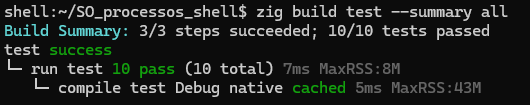
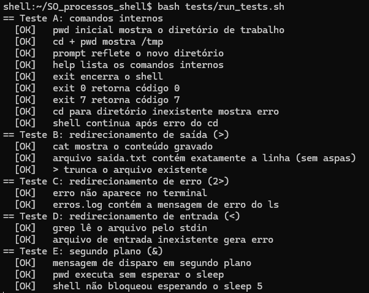
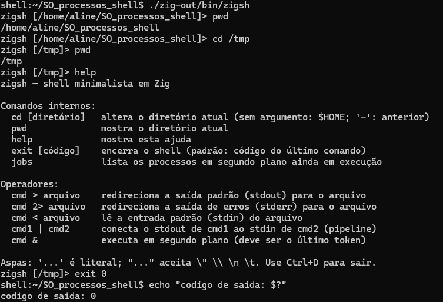
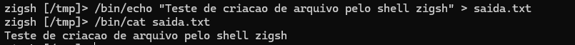
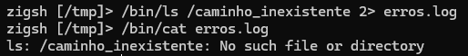
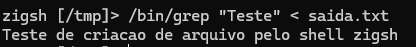
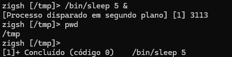
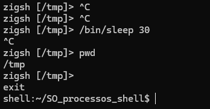

# Relatório — Construção de um Shell Básico em Linux (zigsh)

| | |
|---|---|
| **Trabalho** | Trabalho Prático Avaliativo — Shell básico em Linux |
| **Nomes** | Aline Douaki, Guilherme Biribilli, Mateus Borba |


## 1. Objetivo

Este trabalho implementa o **zigsh**, um interpretador de comandos minimalista
para Linux escrito na linguagem Zig (versão 0.16.0). O objetivo é aplicar, na
prática, os conceitos de gerenciamento de processos estudados na disciplina:
criação e espera de processos filhos, execução em primeiro e segundo plano,
redirecionamento de descritores de entrada e saída e comunicação entre
processos por meio de pipes.

## 2. Ambiente de desenvolvimento e testes

| Item | Valor |
|---|---|
| Sistema operacional | Alpine Linux (imagem virt x86_64) |
| Virtualização | Oracle VirtualBox, acesso via SSH |
| Arquitetura | x86_64 |
| Linguagem | Zig 0.16.0 |
| Código-fonte | [`src/main.zig`](../src/main.zig) (arquivo único) |
| Testes automáticos | `zig build test` (unitários) e [`tests/run_tests.sh`](../tests/run_tests.sh) (roteiro A–F) |

## 3. Como compilar e executar

Dentro da pasta do projeto:

```sh
zig build                     #compila: gera zig-out/bin/zigsh
./zig-out/bin/zigsh           #executa o shell
zig build test --summary all  #testes unitários do tokenizador/parser
bash tests/run_tests.sh       #roteiro de testes A–F + extras
```

## 4. Implementação

### 4.1 Visão geral

O programa segue o ciclo clássico de um shell (REPL). A cada volta, ele:

1. coleta os processos em segundo plano que já terminaram;
2. exibe o prompt com o diretório atual;
3. lê uma linha;
4. quebra a linha em tokens;
5. monta a estrutura do comando (pipeline, redirecionamentos e `&`);
6. executa como comando interno ou cria os processos filhos;
7. espera os filhos, se o comando estiver em primeiro plano.

O código segue a estrutura do esqueleto fornecido (`ParsedCommand`, função
`main` no padrão *Juicy Main*), e as seções estão marcadas com os mesmos
números dos TODOs do enunciado (TODO 1 a TODO 8).

### 4.2 Requisitos atendidos

| Requisito | Como foi implementado | Onde (`src/main.zig`) |
|---|---|---|
| 1 — REPL e prompt | Prompt `zigsh [<diretório>]>` obtido com `std.process.currentPath`; leitura até `\n`; Ctrl+D (EOF) encerra o shell imprimindo `exit`. | `Shell.printPrompt`, `run` |
| 2 — Parsing | Tokenização por espaços, com reconhecimento de `>`, `2>`, `<`, `\|` e `&` (este último apenas no final da linha). | `tokenize`, `parse` |
| 3 — Comandos internos | `cd`, `pwd`, `help` e `exit [código]` executados no próprio processo do shell, sem criar filhos. | `Shell.runBuiltin` |
| 4 — Comandos externos | Criação do filho com `std.process.spawn` (estrutura `std.process.Child`) e espera síncrona com `child.wait()`. | `Shell.runExternal` |
| 5 — Redirecionamento | Arquivos abertos com `std.Io.Dir.cwd()` e entregues ao filho como stdin, stdout ou stderr. | `openInput`, `createOutput` |
| 6 — Segundo plano | Com `&`, o processo é criado sem `wait()`; o shell mostra a mensagem de disparo e volta imediatamente ao prompt. | `Shell.runExternal` (TODO 8) |
| 7 — Pipeline | O stdout do estágio *i* é criado como `.pipe`, e a ponta de leitura vira o stdin do estágio *i+1*. O shell espera todos os processos. | `Shell.runExternal` (TODO 7) |

### 4.3 Decisões de projeto

**Pipeline sem cópia de dados pelo shell.** O shell não lê a saída do
primeiro processo para depois escrevê-la no segundo. A ponta de leitura do
pipe é passada diretamente como entrada do processo seguinte. No Linux isso
corresponde a um `dup2` no processo filho, e os dados trafegam de um processo
ao outro pelo kernel. Assim os estágios rodam em paralelo e não há risco de
travamento com o pipe cheio. O pipeline aceita qualquer número de estágios.

**Fechamento das pontas do pipe no pai.** Logo após criar cada estágio, o
shell fecha a sua cópia da ponta de leitura. Sem isso, em um comando como
`yes | head -n 1`, o processo `yes` nunca receberia o sinal `SIGPIPE` e
ficaria bloqueado para sempre. Esse caso faz parte dos testes.

**Redirecionamentos abertos antes de criar processos.** Todos os arquivos são
abertos antes do primeiro `spawn`. Se algum falhar (por exemplo,
`< arquivo_inexistente`), nenhum processo é criado e o shell exibe o erro,
como acontece no bash.

**Coleta de processos em segundo plano.** Antes de cada prompt, o shell
verifica com `waitpid(..., WNOHANG)`, sem bloquear, quais jobs terminaram.
Isso evita processos zumbis, e o shell avisa o usuário:
`[1]+ Concluído (código 0)    /bin/sleep 5`. Os jobs em segundo plano também
são colocados em um grupo de processos próprio, para não receberem o Ctrl+C
digitado no terminal.

**Ctrl+C.** O shell instala um tratador para `SIGINT`, e não `SIG_IGN`,
porque tratadores voltam ao comportamento padrão após o `execve`. Com isso,
um comando em primeiro plano continua sendo interrompido pelo Ctrl+C,
enquanto o shell apenas pula de linha e exibe o prompt novamente.

**Aspas e `\n`.** Para que o Teste F produza exatamente `Alvo 123`, o zigsh
converte `\n` em quebra de linha dentro de aspas duplas (o `/bin/echo` não faz
essa conversão sem a opção `-e`). Dentro de aspas simples, o texto é mantido
literal.

### 4.4 Adaptações à API do Zig 0.16

O esqueleto do enunciado usa nomes de versões anteriores da biblioteca padrão
que não existem na versão 0.16.0. Foram usados os equivalentes atuais:

| No esqueleto | No Zig 0.16 (utilizado) |
|---|---|
| `std.io.getStdIn().reader()` | `std.Io.File.stdin().readerStreaming(io, &buf)` |
| `std.io.getStdOut().writer()` | `std.Io.File.stdout().writerStreaming(io, &buf)` |
| `std.ArrayList(T).init(alloc)` | `std.ArrayList(T) = .empty` + `append(alloc, x)` |
| `GeneralPurposeAllocator` | `init.gpa` (fornecido pela *Juicy Main*) |
| `std.process.changeCurDir()` | `std.process.setCurrentPath(io, caminho)` |
| `getCwd` | `std.process.currentPath(io, &buf)` |
| `std.fs.cwd()` | `std.Io.Dir.cwd()` |
| `stdout_behavior = .Pipe` | `std.process.spawn(io, .{ .stdout = .pipe, ... })` |

### 4.5 Funcionalidades extras

- Comando interno `jobs`, que lista os processos em segundo plano ainda em execução.
- `cd` sem argumento ou com `~` vai para o diretório pessoal; `cd -` volta ao diretório anterior.
- Redirecionamento também em comandos internos, por exemplo `pwd > dir.txt`.
- Operadores sem espaços ao redor, como `ls>saida.txt`.
- Códigos de saída no padrão do sh: 127 (comando não encontrado), 126 (sem permissão), 128+N (processo encerrado pelo sinal N) e 2 (erro de sintaxe).
- Mensagens de erro em português: comando não encontrado, arquivo inexistente, aspas não fechadas, `|` sem comando e `&` fora do final da linha.

## 5. Testes

### 5.1 Testes automáticos

O projeto tem dois conjuntos de testes automáticos:

- **Testes unitários** (`zig build test`): 10 testes do tokenizador e do
  parser, incluindo aspas, operadores, erros de sintaxe e verificação de
  vazamento de memória.
- **Roteiro de integração** (`tests/run_tests.sh`): executa o zigsh de verdade
  com os comandos dos Testes A–F do enunciado e com casos extras, e confere a
  saída de cada um.

#### Testes unitários



#### Roteiro de integração

Resultado da execução na VM Alpine Linux:

| Grupo | Verificações | Resultado |
|---|---:|---|
| Teste A — comandos internos | 9 | 9 OK |
| Teste B — redirecionamento de saída (`>`) | 3 | 3 OK |
| Teste C — redirecionamento de erro (`2>`) | 2 | 2 OK |
| Teste D — redirecionamento de entrada (`<`) | 2 | 2 OK |
| Teste E — segundo plano (`&`) | 4 | 4 OK |
| Teste F — pipeline (`\|`) | 4 | 4 OK |
| Extras — erros e sintaxe | 7 | 7 OK |
| **Total** | **31** | **31 OK, 0 falhas** |

Saída completa de `bash tests/run_tests.sh`:

```text
== Teste A: comandos internos
  [OK]   pwd inicial mostra o diretório de trabalho
  [OK]   cd + pwd mostra /tmp
  [OK]   prompt reflete o novo diretório
  [OK]   help lista os comandos internos
  [OK]   exit encerra o shell
  [OK]   exit 0 retorna código 0
  [OK]   exit 7 retorna código 7
  [OK]   cd para diretório inexistente mostra erro
  [OK]   shell continua após erro do cd
== Teste B: redirecionamento de saída (>)
  [OK]   cat mostra o conteúdo gravado
  [OK]   arquivo saida.txt contém exatamente a linha (sem aspas)
  [OK]   > trunca o arquivo existente
== Teste C: redirecionamento de erro (2>)
  [OK]   erro não aparece no terminal
  [OK]   erros.log contém a mensagem de erro do ls
== Teste D: redirecionamento de entrada (<)
  [OK]   grep lê o arquivo pelo stdin
  [OK]   arquivo de entrada inexistente gera erro
== Teste E: segundo plano (&)
  [OK]   mensagem de disparo em segundo plano
  [OK]   pwd executa sem esperar o sleep
  [OK]   shell não bloqueou esperando o sleep 5
  [OK]   job concluído é coletado e anunciado
== Teste F: pipeline (|)
  [OK]   saída é exatamente 'Alvo 123'
  [OK]   pipeline com 3 estágios
  [OK]   pipeline com < no início e > no fim
  [OK]   yes | head termina (pai fecha as pontas do pipe)
== Extras: erros e sintaxe
  [OK]   comando inexistente
  [OK]   código 127 para comando inexistente
  [OK]   pipe sem comando é erro de sintaxe
  [OK]   aspas não fechadas
  [OK]   & fora do final é erro de sintaxe
  [OK]   redirecionamento em comando interno
  [OK]   aspas simples são literais

Resultado: 31 OK, 0 falha(s)
```

Print da execução no terminal (início da saída):



### 5.2 Roteiro de testes do enunciado (execução manual)

Os testes abaixo foram executados digitando os comandos diretamente no zigsh.

#### Teste A — Comandos internos

```text
pwd
cd /tmp
pwd
help
exit 0
```

**Esperado:** o `pwd` mostra o diretório atual; após `cd /tmp`, o prompt muda
para `zigsh [/tmp]>` e o `pwd` mostra `/tmp`; o `help` lista os comandos
internos; o `exit 0` encerra o shell com código 0.



#### Teste B — Redirecionamento de saída

```text
/bin/echo "Teste de criacao de arquivo pelo shell zigsh" > saida.txt
/bin/cat saida.txt
```

**Esperado:** nada aparece no terminal no primeiro comando; o `cat` mostra
`Teste de criacao de arquivo pelo shell zigsh`.



#### Teste C — Redirecionamento de erro

```text
/bin/ls /caminho_inexistente 2> erros.log
/bin/cat erros.log
```

**Esperado:** a mensagem de erro do `ls` não aparece no terminal; ela fica
gravada em `erros.log` e é exibida pelo `cat`.



#### Teste D — Redirecionamento de entrada

```text
/bin/grep "Teste" < saida.txt
```

**Esperado:** o `grep` lê o arquivo pela entrada padrão e mostra a linha que
contém "Teste".



#### Teste E — Execução em segundo plano

```text
/bin/sleep 5 &
pwd
```

**Esperado:** aparece `[Processo disparado em segundo plano] [1] <PID>`, e o
`pwd` responde imediatamente, sem esperar os 5 segundos. Depois que o `sleep`
termina, o shell avisa antes do prompt seguinte:
`[1]+ Concluído (código 0)    /bin/sleep 5`.



#### Teste F — Encadeamento por pipeline

```text
/bin/echo "Linha 1\nLinha 2\nAlvo 123" | /bin/grep "Alvo"
```

**Esperado:** é exibida apenas a linha `Alvo 123`.


### 5.3 Testes interativos de teclado

Estes comportamentos dependem do teclado e não são cobertos pelo script
automático:

| Ação | Comportamento esperado |
|---|---|
| Ctrl+C no prompt | O shell não encerra; apenas pula de linha e mostra o prompt |
| `/bin/sleep 30` e depois Ctrl+C | O `sleep` é interrompido e o shell continua aberto |
| Ctrl+D no prompt | O shell imprime `exit` e encerra |



## 6. Limitações

- Não há expansão de variáveis (`$HOME`), curingas (`*.txt`), redirecionamento
  com acréscimo (`>>`), operadores `&&`, `||` e `;`, nem controle interativo de
  jobs (`fg`, `bg`, Ctrl+Z).
- Comandos internos não podem fazer parte de um pipeline, porque alteram o
  estado do próprio shell; o zigsh recusa esse uso com uma mensagem
  explicativa.

## 7. Conclusão

O zigsh atende aos sete requisitos do enunciado e passou em todos os testes do
roteiro (31 verificações automáticas) no Alpine Linux. O desenvolvimento
permitiu aplicar na prática a criação de processos com `fork`/`exec` (por meio
de `std.process.Child`), a espera síncrona e assíncrona de processos filhos, o
redirecionamento de descritores de arquivo e a comunicação entre processos por
pipes. Também mostrou a importância de detalhes como fechar as pontas não
usadas de um pipe e coletar os processos em segundo plano para evitar zumbis.
